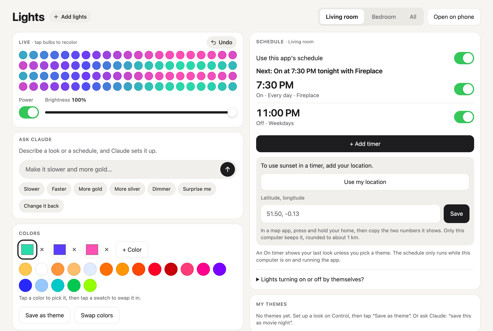

# Govee Lights

[](https://github.com/SaarthurR/govee-lights-app/actions/workflows/test.yml)

Moving, bulb-by-bulb effects and smarter timers for Govee light strips, from your computer or any phone on your Wi-Fi. No cloud, no account.



Wave, shimmer, twinkle, fire, aurora and more in your colors; tap bulbs to paint them; save themes; timers at a time or at sunset; an optional Ask Claude chat ("make it a slow police light"). It also works on a phone ([screenshot](docs/phone.png)): click **Open on phone** and scan the code.

## Install

You need Python 3.10 or newer, and a computer that stays on while your timers should run.

Mac or Linux, in Terminal:

```sh
curl -fsSL https://raw.githubusercontent.com/SaarthurR/govee-lights-app/main/install.sh | sh
```

Windows, in PowerShell:

```powershell
irm https://raw.githubusercontent.com/SaarthurR/govee-lights-app/main/install.ps1 | iex
```

Then **open Govee Lights from Launchpad** (Mac), **the Start Menu** (Windows) or **your app menu** (Linux). No Terminal needed after this.

**On a Mac, click Allow** when macOS asks to let Govee Lights find devices on your local network. Without it the app cannot reach your lights. If the installer says the native app could not be built, run `xcode-select --install` and install again.

The installer downloads this repo into `govee-lights` in your home folder, adds the app, and starts Lights at login (no admin needed). Run it again to update; your lights, themes and timers are kept. Lights also updates itself from `main` about once a day; turn **Auto-update** off in **Settings** to stop that. Read the scripts first if you like: [install.sh](install.sh), [install.ps1](install.ps1).

## Set up

1. In the Govee Home app, open each light, tap the gear and turn on **LAN Control**.
2. Open Govee Lights. It scans your Wi-Fi; click **Flash** to see which light is which, then name them.
3. For your phone, click **Open on phone**, scan the code, then **Share → Add to Home Screen**. The phone must be on the same Wi-Fi.

Add, rename or remove lights later with **Manage lights** at the top of the page.

## Supported lights

| Level | Model | What works |
| --- | --- | --- |
| Tested | H805D | Per-bulb effects (132 bulbs, each its own color), paint, power, brightness, timers. |
| Should work | H619A | Per-bulb effects (20 color slots) from [OpenRGB's model table](https://github.com/CalcProgrammer1/OpenRGB/blob/master/Controllers/GoveeController/RGBController_Govee.cpp#L38-L58); not tested on real hardware. |
| Basic | Other models with LAN Control | On/off, brightness, one solid color and timers. |

Govee's [LAN guide](https://app-h5.govee.com/user-manual/wlan-guide) lists most models with LAN Control. Please [open an issue](https://github.com/SaarthurR/govee-lights-app/issues) with your model and whether it worked, or use **Send feedback** in **Settings**.

## Uninstall

Mac or Linux (keeps `~/govee-lights/state.json`; use `--purge` to delete it too):

```sh
curl -fsSL https://raw.githubusercontent.com/SaarthurR/govee-lights-app/main/install.sh | sh -s -- --uninstall
```

Windows (keeps state; use `-Purge` to delete it too):

```powershell
& ([scriptblock]::Create((irm https://raw.githubusercontent.com/SaarthurR/govee-lights-app/main/install.ps1))) -Uninstall
```

## Troubleshooting

**No lights found.** Check LAN Control is on, and that the light and computer share a Wi-Fi network (not a guest network). Some routers block devices from seeing each other; turn off "client isolation" or "AP isolation". Allow Python through your firewall. On a Mac, turn on Govee Lights in System Settings → Privacy & Security → Local Network. Then click **Scan again**.

**Lights stuck or not changing.** Click **Reconnect** in **Settings**, for example after a power cut. Run only one copy of the app.

**Lights turn on or off by themselves.** Timers made in Govee Home keep running, and other apps cannot read them. Check Timer and Automation in Govee Home, or turn off **Use this app's schedule** for that light.

**The phone can't open the page.** Use the same Wi-Fi as the computer and allow incoming connections on port 8765.

## How it works

`server.py` (Python standard library only) talks to the lights over the Govee LAN API and serves `index.html`, the whole page. It only answers devices on your home network. Everything is saved in `state.json` next to it. Protocol notes are in [docs/protocol.md](docs/protocol.md). The optional Govee account only reads light and scene names. Ask Claude uses the [Claude Code](https://docs.anthropic.com/en/docs/claude-code) `claude` command if you have it, and Claude can only return a checked list of app actions, never code.

Try it without lights: `GOVEE_DRY=1 GOVEE_FAKE_LIGHTS=2 PORT=8768 python3 server.py`. Tests: `python3 -m unittest discover -s tests`, `node tests/test_ask.js`, `node tests/test_feedback.js` and `node tests/test_colors.js`. CI also runs the real installers on macOS, Windows and Linux in dry mode (`tests/install_check.py`).

Color controls use locally bundled dnd kit and vanilla-colorful; no CDN or Node.js is needed to run the app. To rebuild `vendor/color-controls.js`, run `npm ci --prefix ui && npm run --prefix ui build`. Sources and pinned versions are in `ui/`; third-party licenses are in `vendor/LICENSES.txt`.

## License

MIT, see [LICENSE](LICENSE). Not affiliated with Govee. Govee is a trademark of its owner.
