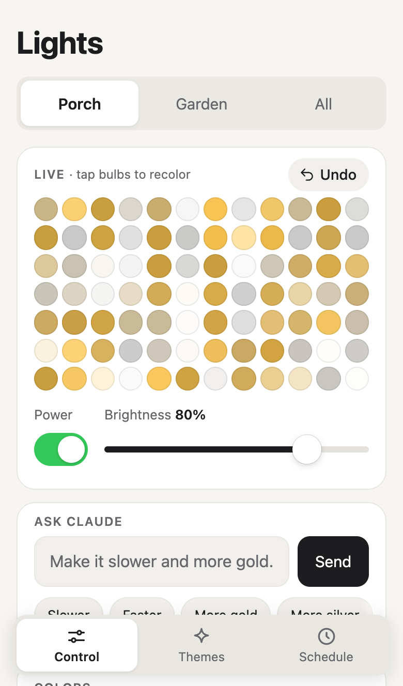
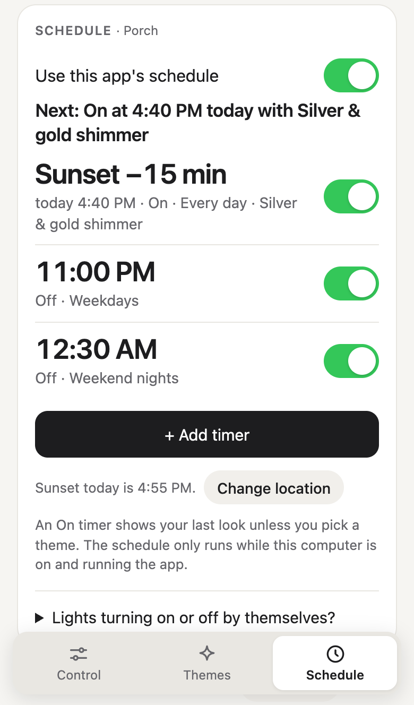
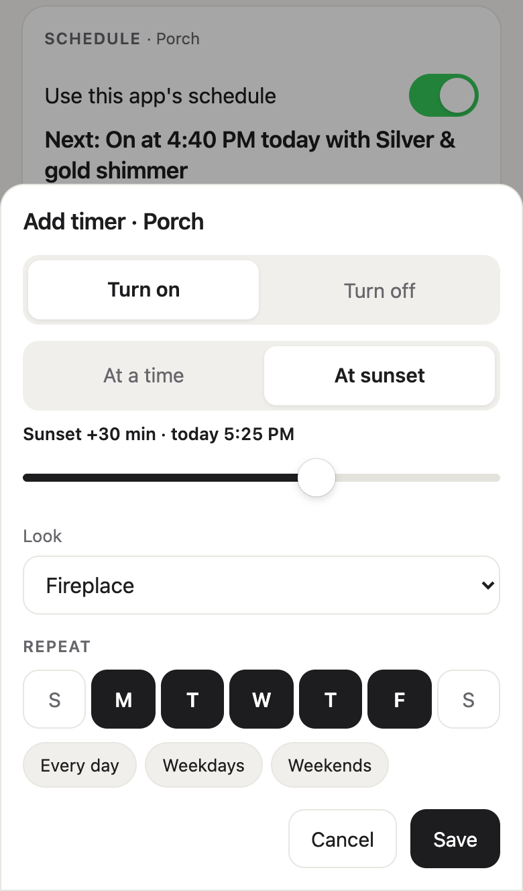

# Lights

Moving, bulb-by-bulb effects and smarter timers for Govee light strips, from any phone or computer on your Wi-Fi. No cloud, no account.

  
  
  

## Features

- **Live strip.** See every bulb, tap bulbs to paint them, set power and brightness.
- **Effects in your colors.** Wave, shimmer, twinkle, comet, fire, aurora, chase, breathe, rainbow and more, with speed and amount.
- **Presets and your own themes,** with Undo.
- **Timers like the Govee app, but better.** Up to 10 per light. On or off at a time or at sunset (up to 2 hours before or after), on the days you pick. An On timer can bring up a theme. The page says what happens next and warns you when two timers clash.
- **Setup by Wi-Fi scan.** Tap **Flash** to blink a light and see which one it is.
- **Phone first.** Scan a QR code to open it on your phone, then add it to your home screen.
- **Optional:** an Ask Claude chat ("make it a slow police light", "turn off at midnight on weekends"), and reading your scene names from a Govee account.

## What you need

- A computer that stays on, with Python 3.10 or newer. Nothing else to install. Tested on macOS.
- A Govee light strip with **LAN Control** on. Tested on the **H805D**. Other Govee strips that take per-bulb color over LAN may work, but are untested.
- Optional: the [Claude Code](https://docs.anthropic.com/en/docs/claude-code) `claude` command, signed in, for Ask Claude. Without it the chat card stays hidden.

## Start

1. In the Govee Home app, open your light, tap the settings gear and turn on **LAN Control**. Do this for each light.
2. In this folder, run `python3 server.py` (on Windows: `py server.py`).
3. Open <http://localhost:8765>. The app lists the lights it found on your Wi-Fi. Click **Flash** next to one to make it blink, then name them and click **Save lights**.
4. On the computer, click **Open on phone** and scan the code with your phone camera. The phone must be on the same Wi-Fi. On iPhone, tap Share, then **Add to Home Screen**.

To rename or remove a light later, use **Manage lights** at the bottom of the page.

## Troubleshooting

**No lights found.** Check that LAN Control is on for each light, and that the light and the computer are on the same Wi-Fi (not a guest network). Some routers block the scan between devices; turn off "client isolation" or "AP isolation" if yours has it. If your computer has a firewall, allow incoming connections for Python. Then select **Scan again**.

**Lights stuck or not changing.** Use **Reconnect** at the bottom of the page. After a power cut a strip drops out of per-bulb mode, and Reconnect brings it back. Run only one copy of this app at a time, or the copies fight over the lights.

**A timer didn't run.** Timers only run while the computer is awake and `server.py` is running. To use sunset, add your location on the Schedule page.

**Lights turn on or off by themselves.** Timers made in the Govee Home app keep running, and Govee doesn't let other apps read them. Check Timer and Automation for that light in Govee Home. To use only Govee's timers for a light, turn off **Use this app's schedule** on the Schedule page; your timers here stay saved. When something else changes a light, this app stops streaming to it until you tap a look or **Reconnect**, and warns you if it keeps happening at the same time.

**The phone can't open the page.** Use the same Wi-Fi as the computer, and allow incoming connections on port 8765 in its firewall.

## How it works

- `server.py` talks to the lights with the Govee LAN API over UDP (scan on ports 4001 and 4002, commands on 4003). It streams 84 colors per frame, 12 frames a second, in Govee's per-bulb `razer` mode. Protocol notes are in `FUNCTIONS.md`.
- `index.html` is the whole page, served by `server.py`. The server only answers devices on your home network.
- Everything is saved in `state.json` next to `server.py`: lights, last looks, themes, timers and location (rounded to about 1 km). Delete it to start over.
- An Off timer that comes before every On timer of that light belongs to the night before. For example, "Off at 12:00 AM, Sat and Sun" turns the light off after Saturday and Sunday evenings.
- The Govee account is optional and read-only. It reads light and scene names with an API key from Govee Home (Profile → Settings → Apply for API key). The key stays in `state.json` and is sent only to Govee.
- Ask Claude uses the Haiku model with a short prompt, so each ask stays cheap. Claude can only return a checked list of actions (looks, painting, timers, themes), never code.
- Try it without lights: `GOVEE_DRY=1 GOVEE_FAKE_LIGHTS=2 PORT=8768 python3 server.py` sends nothing and pretends to find two lights. `python3 -m unittest test_ask` runs the offline tests.

## License

MIT, see [LICENSE](LICENSE).

Not affiliated with Govee. Govee is a trademark of its owner.
